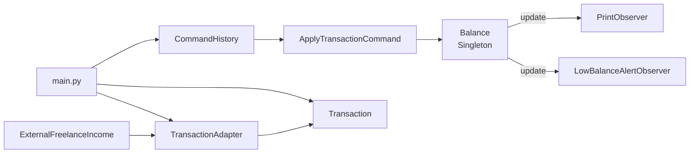

# Personal Finance Manager: Design Patterns Project

A small personal finance manager for the command line. It tracks income and
expenses, keeps a running balance, prints every change and warns when the
balance drops below a threshold. Income from an external freelance platform is
converted into the app's own format, and every transaction can be undone and
redone.

The project is built around four design patterns: **Singleton**, **Adapter**,
**Observer** and **Command**. It uses only the Python standard library.

## Setup and running

Requires **Python 3.10 or newer**. No packages are needed to run the app or
the tests.

```bash
git clone <this repo>
cd <repo>/starter
python main.py
```

Output:

```text
Adding transactions...
Applied Transaction($100, category='TransactionCategory.INCOME') -> balance: $100.00
Applied Transaction($50, category='TransactionCategory.EXPENSE') -> balance: $50.00
ALERT: Low balance! $50.00 is below the threshold of $100.00.
Applied Transaction($200, category='TransactionCategory.INCOME') -> balance: $250.00
Applied Transaction($75, category='TransactionCategory.EXPENSE') -> balance: $175.00
Applied Transaction($1200, category='TransactionCategory.INCOME') -> balance: $1,375.00
Net balance: $1,375.00

Undoing the last transaction...
Applied Transaction($1200, category='TransactionCategory.EXPENSE') -> balance: $175.00
Net balance: $175.00

Redoing it...
Applied Transaction($1200, category='TransactionCategory.INCOME') -> balance: $1,375.00
Net balance: $1,375.00
```

The $1,200 entry is the freelance invoice `INV-98765`, converted by the
adapter. The alert threshold is `LOW_BALANCE_THRESHOLD = 100` in `main.py`.

## Testing

```bash
cd starter
python -m unittest discover        # 46 tests
```

| Test file | What it covers |
|---|---|
| `balance/test_balance.py` | Singleton identity, `Balance()` is blocked, income/expense, invalid category, reset, summary |
| `balance/test_balance_observer.py` | low-balance alert (below, at and above the threshold, recovery), `PrintObserver` output, registering/unregistering observers |
| `balance/test_formatting.py` | money formatting incl. negative amounts and thousands separators |
| `transaction/test_transaction.py` | creation, `str`, equality and hashing, immutability, invalid amounts, `inverse()` |
| `transaction/test_transaction_adapter.py` | conversion of freelance income, applying it to the balance, invalid external data |
| `commands/test_commands.py` | execute/undo for income and expense, undo notifies observers, undo/redo stacks, redo cleared by a new command |
| `test_main.py` | the full demo: final balance, printed changes and the alert |

The observers write through an injected `output` function, so the tests check
messages without capturing the console.

### Optional code-quality tools

```bash
python -m venv .venv
.venv/Scripts/activate            # Windows; macOS/Linux: source .venv/bin/activate
pip install -r requirements-dev.txt
cd starter
black --check . && isort --check-only . && flake8 . && pycodestyle . && mypy .
coverage run --rcfile=../pyproject.toml -m unittest discover
coverage report --rcfile=../pyproject.toml
```

Current results: black, isort, flake8, pycodestyle and mypy (`strict`) report no issues.
Coverage of the application code is 99 %. The only line not run by the tests
is the `if __name__ == "__main__"` guard.

## Project structure

```text
starter/
├── main.py                              # composes the app and runs the demo
├── balance/
│   ├── balance.py                       # Balance: Singleton + Observer subject
│   ├── balance_observer.py              # IBalanceObserver, PrintObserver, LowBalanceAlertObserver
│   └── formatting.py                    # format_money()
├── transaction/
│   ├── transaction.py                   # Transaction value object
│   ├── transaction_category.py          # TransactionCategory enum (INCOME, EXPENSE)
│   ├── external_income_transaction.py   # ExternalFreelanceIncome (third-party format)
│   └── transaction_adapter.py           # TransactionAdapter
└── commands/
    ├── transaction_command.py           # Command, ApplyTransactionCommand
    └── command_history.py               # CommandHistory (undo/redo)
```

Tests sit next to the module they test, as in the starter code.



## Design patterns

### 1. Singleton: `Balance`

**Where:** `balance/balance.py`

**What it does:** There is one balance per application. `Balance.get_instance()`
creates it on first use and returns the same object afterwards. `Balance()`
raises `RuntimeError`, so a second instance can't be created by mistake.
Creation is protected by a lock, so two threads can't create two balances at
the same time.

**Why it fits:** Every part of the app must read and change the same number.
With two balance objects, an expense could land on one while the alert watches
the other.

### 2. Adapter: `TransactionAdapter`

**Where:** `transaction/transaction_adapter.py`,
`transaction/external_income_transaction.py`

**What it does:** `ExternalFreelanceIncome` is the freelance platform's format
(amount, invoice ID, description, a text field `typ`). `TransactionAdapter`
turns it into a `Transaction(amount, TransactionCategory.INCOME)`. It rejects
records that are not income or have an invalid amount, because the app does
not control this data.

**Why it fits:** The platform's format isn't ours to change. The adapter keeps
the rest of the app free of it: `Balance`, the observers and the commands only
know `Transaction`. If the platform changes its format, or a second platform
is added, only an adapter changes.

### 3. Observer: `PrintObserver` and `LowBalanceAlertObserver`

**Where:** `balance/balance_observer.py`, subject in `balance/balance.py`

**What it does:** `Balance` keeps a list of `IBalanceObserver`s. After each
transaction it calls `update(balance, transaction)` on each of them.

- `PrintObserver` prints the transaction and the new balance.
- `LowBalanceAlertObserver(threshold)` prints an alert while the balance is
  below the threshold. `alert_triggered` shows the state after the last
  update. A balance exactly at the threshold is not an alert.

`add_income()` and `add_expense()` also go through `apply_transaction()`, so
no change can bypass the observers.

**Why it fits:** The balance shouldn't need to know who cares about it. New
reactions (an email, a log file, a monthly budget check) are new observer
classes, and `Balance` stays unchanged.

### 4. Command: `ApplyTransactionCommand` and `CommandHistory` (own choice)

**Where:** `commands/transaction_command.py`, `commands/command_history.py`

**What it does:** Every transaction is wrapped in an `ApplyTransactionCommand`
with `execute()` and `undo()`. `CommandHistory` (the invoker) runs commands and
keeps an undo and a redo stack. A new command clears the redo stack, as in a
text editor. `undo()` does not change the balance directly. It applies the
inverse transaction (an income becomes an expense of the same amount), so the
observers see the correction as well. If undoing an income drops the balance
below the threshold, the alert fires.

**Why I chose it:** A mistyped expense is the most common error in a finance
app, and it should be easy to fix. Undo/redo is the classic use case for
Command, and it was listed as a suggestion in the project description.
Strategy (budget rules) would have added a new feature. Command improves how
the existing core feature, applying transactions, works.

**How it helps:**

- **Flexibility:** new actions (e.g. a transfer between two accounts) are new
  command classes. `CommandHistory` gets undo and redo for them without
  changes.
- **Testability:** a command is a small object with two methods and an
  injected balance, so it can be tested alone. The tests cover undo for both
  categories and the interaction with the alert.
- **Scalability:** the history is a natural place for later features such as
  an audit log or saving and replaying transactions.

### Dependency injection

The components get their dependencies from outside instead of creating them:

- `main.py` is the only place that wires things together.
  `create_balance(observers)` registers the observers, and each
  `ApplyTransactionCommand` receives the balance in its constructor.
- The observers receive their `output` function (default `print`). Tests pass
  `list.append` and check the messages directly.
- Only `main.py` calls `Balance.get_instance()` directly. The commands only
  know "a balance".

## Reflection

**Singleton.** It guarantees that everything works on the same balance, and
`Balance()` can't slip through by accident. The downside showed up in the
tests: the singleton keeps its state between tests. A value or an observer
left over from one test can break the next one. The test from the starter
code, for example, registered an observer and never removed it, so later tests
printed alerts. I solved this with `reset()` and `clear_observers()` in every
`setUp`. It works, but it's the price of global state. That's also why the
commands receive the balance through injection instead of calling
`get_instance()` themselves.

**Adapter.** It was the simplest of the four patterns and kept the external
format out of the rest of the app. The trade-off: `Transaction` only stores
amount and category, so the invoice ID and description are lost during
conversion. Keeping them would need a description field in `Transaction`, and
that would change the equality the starter tests expect.

**Observer.** It separated the balance from its reactions. Two decisions were
not obvious. Should the alert fire on every transaction below the threshold or
only when the balance crosses it? The starter test requires `alert_triggered`
to show the current state, so the alert repeats as long as the balance stays
low. And should observers receive the whole `Balance` object? I only pass the
number, so an observer can't change the balance.

**Command.** Undo/redo fitted in without touching `Balance`. The key decision
was to implement undo as an inverse transaction instead of subtracting
directly. Otherwise observers wouldn't notice undos, and the alert could stay
silent although the balance is low. The trade-off is that the printout shows
an undo as a normal opposite transaction, not as "undo".

**Other trade-offs.**

- Amounts are `int` or `float`. For real money `decimal.Decimal` would be more
  precise. I kept floats because the starter code and tests use plain numbers,
  and the output is rounded to cents.
- The starter tests, the class names (`PrintObserver`, `typ`) and the
  `Transaction.__str__` format are unchanged, so the provided tests still
  describe the expected behavior. I only added type annotations to the tests,
  made them clean up after themselves and added more tests.
- `Transaction` accepts any category object, because a starter test builds a
  transaction with a fake category and expects `Balance.apply_transaction` to
  reject it. So the check happens in the balance, not in the constructor.

## License

[License](LICENSE.txt)
